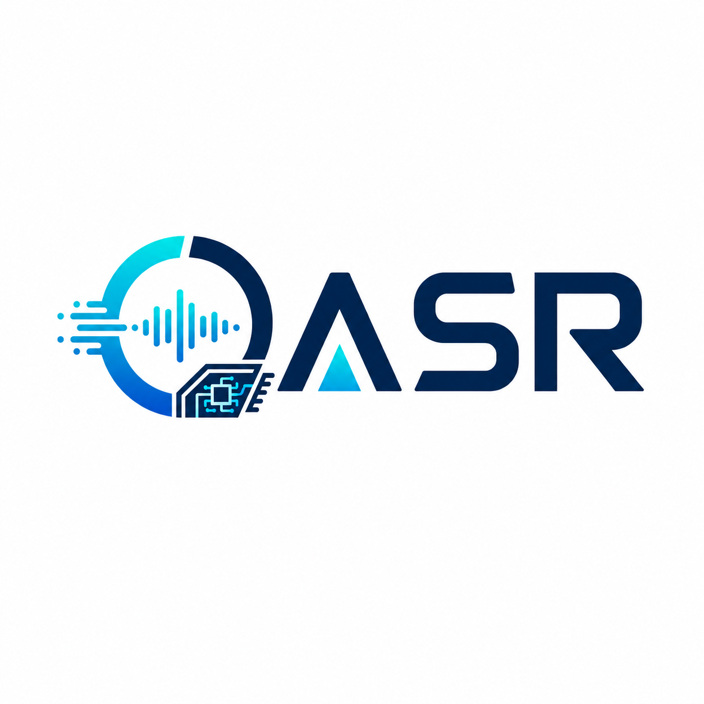

<p align="center">
  <picture>
    
  </picture>
</p>

<h3 align="center">
Easy, fast, and cheap ASR serving for everyone
</h3>

<p align="center">
  <a href="LICENSE"></a>
  
  
  <a href="https://github.com/chiendb97/oasr/actions/workflows/lint.yml"></a>
  <a href="https://github.com/chiendb97/oasr/actions/workflows/test-cpu.yml"></a>
</p>

<p align="center">
  <a href="#quick-start">Quick start</a> ·
  <a href="#supported-models">Models</a> ·
  <a href="docs/README.md">Documentation</a> ·
  <a href="docs/faq.md">FAQ</a> ·
  <a href="CONTRIBUTING.md">Contributing</a>
</p>

---

**OASR** (Open Automatic Speech Recognition) is an open-source inference and serving engine for
speech recognition on NVIDIA GPUs. It runs **Whisper**, **WeNet Conformer**, **icefall Zipformer and
RNN-T**, **NVIDIA Nemotron ASR**, **FunASR Paraformer** and **Qwen2-Audio** checkpoints, offline or
streaming, from one engine built on custom CUDA/CUTLASS kernels, and serves them through an
**OpenAI-compatible** HTTP API, a realtime WebSocket and gRPC.

## Why OASR

- **A self-hosted, OpenAI-compatible speech-to-text API.** Clients of `/v1/audio/transcriptions`,
  including the official `openai` SDKs and plain `curl`, work after a base-URL change, with SRT/VTT
  subtitles, word timestamps and streamed output.
- **Real-time streaming recognition.** Partial transcripts arrive over a WebSocket, server-sent
  events or gRPC bidirectional streaming, with concurrent streams batched dynamically on the GPU.
- **One server for models from many toolkits.** WeNet, icefall/k2, FunASR and Hugging Face
  checkpoints load as released, with no ONNX or TensorRT export step.
- **Efficient GPU use.** Custom kernels, dynamic batching, CUDA-graph capture, paged caches, GPU
  CTC and WFST beam search, and W8A8 int8/fp8 quantization keep cost per audio-hour down.

## Key Features

**Performance**

- Custom CUDA / CUTLASS kernels for GEMM, attention, normalization, convolution, feature extraction
  and decoding, JIT-compiled for your GPU on first use
- Dynamic batching of offline and streaming requests, with length bucketing and sequence packing
  for offline
- CUDA-graph capture of the offline forward, the steady-state streaming encoder and autoregressive
  decoder steps
- Paged KV cache for streaming attention and for autoregressive decoders
- W8A8 int8 and fp8 quantization, online or calibrated with SmoothQuant (`oasr quantize`), plus
  an fp8 KV cache
- FP16 / BF16 / FP32 paths from Turing through Blackwell (SM75–SM120)

**Models and decoding**

- Seven architectures across five decode families: CTC, RNN-T, AED, NAR (CIF) and speech-LLM
- Checkpoints load directly from Hugging Face, WeNet, icefall and FunASR, with no conversion step
- Decoders: CTC greedy and prefix beam, GPU WFST beam search, transducer and AED greedy/beam, and
  CTC+AED rescoring
- Word-level timestamps and confidences across CTC, RNN-T, AED and CIF, each from the model's own
  alignment. Families that have no alignment refuse the request rather than fake one.
- Voice activity detection as its own extension axis: segment long audio at speech boundaries and
  end streaming turns on silence, with a separate VAD model (Silero v5, rebuilt on `oasr.layers`)
  **or** with the ASR model's own per-frame output when none is configured

**Serving**

- A production Rust frontend with an **OpenAI-compatible** HTTP API, a realtime WebSocket and gRPC
- Real-world audio in: MP3, M4A/AAC, FLAC, OGG Vorbis, WAV, AIFF and G.711 telephony, at any sample
  rate
- Prometheus metrics, health and readiness probes, and a Grafana dashboard
- An `oasr` CLI and a Python client, so trying it needs no code

## Supported Models

| Architecture | Registry key   | Decode family                | Offline | Streaming | Source format |
|--------------|----------------|------------------------------|---------|-----------|---------------|
| Conformer (U2/U2++) | `conformer` | CTC (beam / WFST) + CTC/AED rescoring | ✅ | ✅ | WeNet |
| Zipformer    | `zipformer`    | CTC (beam / WFST)            | ✅ | ✅ | icefall |
| Transducer (RNN-T) | `transducer` | Transducer (greedy + beam) | ✅ | ✅ | icefall |
| Nemotron ASR (FastConformer + RNN-T) | `nemotron` | Transducer | ✅ | ✅ | Hugging Face |
| Whisper      | `whisper`      | AED (greedy + beam)          | ✅ | — | Hugging Face |
| Paraformer   | `paraformer`   | NAR / CIF (with timestamps)  | ✅ | — | FunASR |
| Qwen2-Audio (speech-LLM) | `speech_llm` | LLM (token-streaming partials) | ✅ | — | Hugging Face |

The test suite runs against released checkpoints, including `openai/whisper-tiny`,
`nvidia/nemotron-3.5-asr-streaming-0.6b`, `Qwen/Qwen2-Audio-7B-Instruct`, `funasr/paraformer-zh`,
the icefall LibriSpeech Zipformer CTC and transducer releases, and WeNet's LibriSpeech U2++
Conformer. See [`docs/models.md`](docs/models.md) for the decode-family matrix, and
[`docs/architecture.md`](docs/architecture.md) to register an architecture of your own.

---

## Quick Start

```bash
# 1. Install from source (the CUDA kernels JIT-compile on first use)
git clone https://github.com/chiendb97/oasr.git && cd oasr
git submodule update --init
pip install -e ".[all]"

# 2. Serve a model straight from the Hugging Face Hub
oasr-server --ckpt-dir openai/whisper-tiny --service-mode offline

# 3. Transcribe, from another shell
oasr transcribe meeting.mp3
curl -sS http://127.0.0.1:8080/v1/audio/transcriptions -F file=@meeting.mp3 -F model=whisper-1
```

> [!IMPORTANT]
> OASR installs from source. Its package is named `oasr-server` and imports as `oasr`. The
> `oasr` package on PyPI is an **unrelated project**: `pip install oasr` does not install
> this engine, and it replaces the `oasr` command.

Questions about GPUs, models, streaming or alternatives are answered in the [FAQ](docs/faq.md).

### Requirements

- NVIDIA GPU with compute capability 7.5 or newer (Turing through Blackwell)
- CUDA ≥ 11.8
- Python ≥ 3.10
- CMake ≥ 3.18
- Rust toolchain + `protobuf-compiler`

### Install

```bash
git submodule update --init     # provides 3rdparty/cutlass

# Editable install — kernels are JIT-compiled on first use
pip install -e .

# Target specific GPU architectures
CUDA_ARCHITECTURES="80;86;90" pip install -e .

# Optional extras
pip install -e ".[all]"         # audio + hub + tokenizers + attention + serving
pip install -e ".[audio]"       # torchaudio, soundfile, librosa, kaldifeat
pip install -e ".[hub]"         # Hub download + native-checkpoint I/O
pip install -e ".[tokenizers]"  # sentencepiece + tokenizers
pip install -e ".[attention]"   # CuTeDSL fused attention (SDPA fallback without it)
pip install -e ".[serving]"     # client libs for the benchmark scripts
pip install -e ".[wfst]"        # k2 — offline WFST graph export only, never at decode time

# Optional: standalone server binary at rust/target/release/oasr-server
cd rust && cargo build --release
```

### Docker

```bash
docker build -f docker/Dockerfile -t oasr .
docker run --gpus all --rm -p 8080:8080 -v /path/to/models:/models oasr \
    oasr-server --ckpt-dir /models/whisper-tiny --service-mode offline
```

The image builds OASR from source, including the k2-backed WFST decoder, and puts `oasr-server` on
`PATH`.

---

## Checkpoints

WeNet, icefall, FunASR, and Hugging Face checkpoints load as-is: the format is auto-detected, and the
tokenizer, feature frontend, and decoding defaults travel with the checkpoint.

| Source format | Architectures                          |
|---------------|----------------------------------------|
| Hugging Face  | `whisper`, `speech_llm`, `nemotron`    |
| WeNet         | `conformer`                            |
| icefall       | `zipformer`, `transducer`              |
| FunASR        | `paraformer`                           |
| OASR native   | any                                    |

```python
from oasr.engine import ASREngine, EngineConfig

# A local directory in any supported format, or a Hugging Face Hub repo id
engine = ASREngine(EngineConfig(ckpt_dir="openai/whisper-tiny", service_mode="offline"))
```

`oasr-convert <src> <dst>` materializes any supported directory as a native bundle
(safetensors + tokenizer assets) that loads with no format conversion.

See [`docs/checkpoints.md`](docs/checkpoints.md) for detection rules, the converter contract, and the
native format.

---

## Usage

### From the command line

```bash
# Against a running server (see Serving below)
oasr transcribe meeting.mp3
oasr translate  entretien.m4a --language fr
oasr transcribe talk.wav --response-format srt -o talk.srt
oasr transcribe talk.wav --response-format verbose_json --timestamp-granularity word

# Or in-process, no server at all
oasr transcribe meeting.mp3 --ckpt-dir /path/to/checkpoint
```

MP3, M4A, FLAC, OGG Vorbis, WAV, AIFF and G.711 telephony audio all work as-is — no transcoding, and
any sample rate is resampled to the model's.

### From Python

An engine is pinned to one mode for its lifetime by `EngineConfig.service_mode` — `"streaming"` (the
default) or `"offline"`.

### Offline transcription

```python
from oasr.engine import ASREngine, EngineConfig

engine = ASREngine(EngineConfig(ckpt_dir="/path/to/checkpoint", service_mode="offline"))

# Single file
text = engine.transcribe_offline("audio.wav")

# Batch — dynamic length-bucketed micro-batches
texts = engine.transcribe_offline(["a.wav", "b.wav", "c.wav"])

# Word timings and confidences (offline; the families that cannot align refuse)
from oasr.engine import DecodingOptions

(out,) = engine.transcribe_outputs(
    [wav], streaming=False, decoding=DecodingOptions(word_timestamps=True)
)
for w in out.words:
    print(f"{w.start:6.2f}-{w.end:6.2f}  {w.confidence:.2f}  {w.word}")
```

### Streaming transcription

```python
from oasr.engine import ASREngine, EngineConfig

engine = ASREngine(EngineConfig(ckpt_dir="/path/to/checkpoint"))  # service_mode="streaming" by default

# Attached-audio streaming — chunk-by-chunk decode, paged KV cache
texts = engine.transcribe(["a.wav", "b.wav", "c.wav"])

# Real-time feed loop
rid = engine.add_streaming_request()
for chunk in mic_chunks():
    engine.feed_chunk(rid, chunk, is_last=False)
    for out in engine.step():
        if not out.finished:
            print("partial:", out.text)
engine.feed_chunk(rid, last_chunk, is_last=True)
final = engine.run()
```

See [`docs/engine.md`](docs/engine.md) for the step loop, batching, and the full `EngineConfig`, and
[`examples/recognize/local_engine.py`](examples/recognize/local_engine.py) for a runnable version of
the above.

### Quantization

```bash
# W8A8 int8 with no calibration (fp8_w8a8 on SM89 and newer)
oasr-server --ckpt-dir /path/to/checkpoint --quantization int8_w8a8

# Calibrated SmoothQuant, written out as a quantized checkpoint
oasr quantize /path/to/checkpoint /path/to/quantized --recipe smoothquant_w8a8 \
    --calib-manifest manifest.jsonl
```

See [`docs/quantization.md`](docs/quantization.md) for the recipes, GPU support and numerics.

---

## Serving

`oasr-server` hosts one in-process `ASREngine` and serves it over HTTP and gRPC. Scale horizontally
by launching one process per GPU.

```bash
oasr-server \
    --ckpt-dir /path/to/checkpoint \
    --service-mode offline \              # or: streaming
    --http-bind 127.0.0.1:8080 \
    --grpc-bind 127.0.0.1:50051
```

### Endpoints

| Surface | Endpoint                                       | Purpose                                  |
|---------|------------------------------------------------|------------------------------------------|
| HTTP    | `POST /v1/audio/transcriptions`                | **OpenAI-compatible** upload. Any container; `json`/`text`/`srt`/`vtt`/`verbose_json`; word timestamps; SSE with `stream=true`. |
| HTTP    | `POST /v1/audio/translations`                  | The same, translating to English (Whisper-family). |
| HTTP    | `GET /v1/realtime`                             | **WebSocket** streaming transcription.   |
| HTTP    | `POST /v1/speech:recognize`                    | Google-STT-shaped unary; raw body, config in the query string — the fastest HTTP path. |
| HTTP    | `GET /v1/models`                               | Loaded model metadata.                   |
| HTTP    | `GET /healthz` / `/readyz` / `/metrics`        | Liveness, readiness, Prometheus metrics. |
| gRPC    | `oasr.speech.v1.Speech/Recognize`              | Synchronous unary (offline mode).        |
| gRPC    | `oasr.speech.v1.Speech/StreamingRecognize`     | Bidi streaming (streaming mode).         |
| gRPC    | `grpc.health.v1.Health/Check` and `Watch`      | Standard gRPC health checking.           |

`oasr-server` has no authentication and does not terminate TLS. Keep it on a private network or
behind a reverse proxy; see [`SECURITY.md`](SECURITY.md).

### Point an existing client at it

```bash
curl -sS http://127.0.0.1:8080/v1/audio/transcriptions \
     -F file=@meeting.mp3 -F model=whisper-1
# {"text": "..."}
```

```python
from openai import OpenAI                              # or: from oasr.client import OASRClient
client = OpenAI(base_url="http://127.0.0.1:8080/v1", api_key="unused")
client.audio.transcriptions.create(model="whisper-1", file=open("meeting.mp3", "rb")).text
```

Streaming has three transports: the `/v1/realtime` WebSocket (browsers and scripts), SSE via
`stream=true`, and the gRPC `StreamingRecognize` RPC (lowest overhead).
[`examples/web`](examples/web) is a browser client against the first.

### gRPC streaming

The first inbound message carries `streaming_config.config`, the rest carry `audio_content` (raw PCM).

```bash
grpcurl -plaintext -import-path rust/proto -proto oasr_speech_v1.proto \
        127.0.0.1:50051 oasr.speech.v1.Speech/StreamingRecognize
```

See [`docs/serving.md`](docs/serving.md) for the full CLI, the wire format, per-request decoding
options, and deployment.

---

## Performance

Throughput and latency depend on the model, GPU, batch size, audio length and whether requests
stream, so measure them on your own hardware. `benchmarks.asrbench` reports latency percentiles,
throughput (RTFx) and word error rate together, across offline, streaming and concurrent-load
protocols:

```bash
python -m benchmarks.asrbench run --profile smoke --backend oasr_engine
```

See [`docs/asrbench.md`](docs/asrbench.md) and [`docs/benchmarks.md`](docs/benchmarks.md).

---

## Documentation

Start at the [documentation index](docs/README.md), or the [FAQ](docs/faq.md) for short answers.

| Document                                             | Covers                                                |
|------------------------------------------------------|-------------------------------------------------------|
| [`docs/faq.md`](docs/faq.md)                         | Supported GPUs and models, the OpenAI-compatible API, alternatives |
| [`docs/architecture.md`](docs/architecture.md)       | Engine extension points (the per-axis registries)     |
| [`docs/engine.md`](docs/engine.md)                   | Engine step loop, batching, CUDA Graph capture        |
| [`docs/scheduler.md`](docs/scheduler.md)             | Request scheduling, starvation bounds, micro-batching |
| [`docs/models.md`](docs/models.md)                   | Model contracts, capabilities, the seven architectures |
| [`docs/decoding.md`](docs/decoding.md)               | Decode families, beam search, decoding options        |
| [`docs/kernels.md`](docs/kernels.md)                 | CUDA/CUTLASS layer, the JIT pipeline, the functional API |
| [`docs/quantization.md`](docs/quantization.md)       | W8A8 int8 / fp8, SmoothQuant, `oasr quantize`, the fp8 KV cache |
| [`docs/checkpoints.md`](docs/checkpoints.md)         | Checkpoint resolution, converter contract, native format |
| [`docs/features.md`](docs/features.md)               | Feature frontends, `FeatureSpec`, streaming framing   |
| [`docs/vad.md`](docs/vad.md)                         | Voice activity: detectors, segmentation, endpointing  |
| [`docs/tokenizers.md`](docs/tokenizers.md)           | Tokenizer axis: kinds and `TokenizerSpec`             |
| [`docs/cache_manager.md`](docs/cache_manager.md)     | Paged streaming cache (`BlockPool`, `StreamContext`)  |
| [`docs/ctc_decoder_gpu.md`](docs/ctc_decoder_gpu.md) | GPU CTC decoder, single- and multi-request flows      |
| [`docs/wfst_decoder_gpu.md`](docs/wfst_decoder_gpu.md) | In-tree GPU WFST decoder: k2-parity semantics, kernel pipeline, streaming |
| [`docs/serving.md`](docs/serving.md)                 | Serving frontend, wire format, deployment             |
| [`docs/benchmarks.md`](docs/benchmarks.md)           | Engine, service and accuracy benchmark recipes        |
| [`docs/asrbench.md`](docs/asrbench.md)               | Cross-backend latency, throughput and streaming benchmark suite |
| [`docs/autotuning.md`](docs/autotuning.md)           | Kernel auto-tuning API and cache format               |

---

## Contributing

Contributions are welcome: bug reports, [model requests](https://github.com/chiendb97/oasr/issues/new?template=model_request.yml),
documentation, kernels and new architectures. Read [`CONTRIBUTING.md`](CONTRIBUTING.md) for the
workflow, and open an issue to discuss substantial changes before submitting a pull request.
Everyone taking part is expected to follow the [Code of Conduct](CODE_OF_CONDUCT.md).
[`AGENTS.md`](AGENTS.md) has the complete engineering rules, for human contributors and coding
agents alike.

## Citation

If you use OASR in your research, please cite it. GitHub's **Cite this repository** button reads
[`CITATION.cff`](CITATION.cff), or use:

```bibtex
@misc{oasr,
  author       = {Dang, Bao Chien},
  title        = {{OASR}: Open Automatic Speech Recognition},
  year         = {2026},
  howpublished = {\url{https://github.com/chiendb97/oasr}}
}
```

## License

OASR is released under the [Apache License 2.0](LICENSE).
